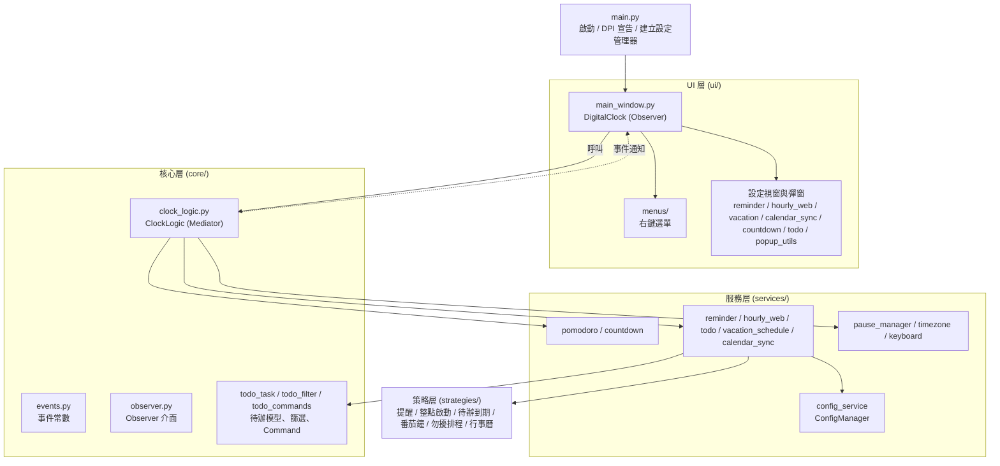

# 桌面數位時鐘 (Digital Clock)

## 緣起
當應用程式最大化時，自動隱藏的工具列雖然釋放了螢幕空間，卻也讓我們無法隨時看到時間。此專案旨在解決這個問題，提供一個簡潔、不干擾且永遠在最上層的桌面時鐘，並整合番茄鐘、倒數計時、提醒、整點啟動、待辦事項等小工具。

- 環境：Python 3.13+（tkinter）
- 依賴（皆列於 `requirements.txt`）：`pynput`（全域鍵盤監聽）；`tkinterdnd2`（選用，整點啟動視窗拖入 XML 匯入，未安裝時改用按鈕匯入）；`icalendar` + `recurring-ical-events`（Outlook 行事曆 ICS 同步，缺少時停用該功能）；Windows 另需 `tzdata`（多時區）

---

## 功能總覽

### 時鐘本體
- **永遠置頂、半透明**：聚焦時不透明（預設 100%），失去焦點時降為預設 50%；兩種透明度皆可在選單調整（100/90/80/70/60%）。
- **可自由拖曳、雙擊關閉**；視窗被限制在可視範圍內（支援 Windows 多螢幕），啟動時若儲存的位置已不在螢幕內會自動移回。
- **滑鼠懸停顯示日期**：游標移到時間上時暫時改顯示日期（含星期），並自動縮小字級避免超出視窗。
- **字元級時間動畫**：時間切換時以字元垂直過渡呈現；動畫期高更新率、閒置期降頻，兼顧流暢與資源。
- **外觀可調**：8 種預設配色（護眼綠、紳士藍、暮色灰、大地棕、琥珀色、經典焦糖、深邃胡桃、柔和奶茶）、字型、字型大小（32–72）、12/24 小時制、完整/簡短日期、圓角（0/12/20/30/40）。「時鐘設定 › 配色方案」可選用配色或以「隨機配色」產生高對比配色；「儲存目前配色…」可命名收藏。右鍵點選配色可刪除（需確認，重啟後仍維持刪除）；刪除目前配色會切換至其他配色，若已無其他配色則產生隨機配色。「隨機配色」入口保留供重新產生。
- **高 DPI 支援（Windows）**：啟動時宣告 DPI 感知，文字不會被系統放大而模糊；最小寬度、內距與圓角會依螢幕縮放。
- **不顯示在工作列**（Windows）；更改副檔名為 `.pyw` 可無主控台視窗背景執行。

### 時鐘下方資訊列
番茄鐘、倒數計時、待辦事項、多時區的資訊集中顯示在時鐘下方，由上而下依序為：

| 項目 | 範例 | 說明 |
|------|------|------|
| 番茄鐘 | `專注 24:16`、`短休息 04:30 (暫停)` | 專注/短休息/長休息階段與剩餘時間，暫停時加註 |
| 倒數計時 | `泡麵 倒數 02:54 (暫停)` | 名稱（可空白）與剩餘時間 |
| 待辦事項 | `待辦 3 項` | 未完成的待辦數（為 0 或設定 `todo.show_in_info_bar` 為 `false` 時不顯示） |
| 多時區 | `東京 00:05 (+1)` | 最多 3 個，跨日以 `(+1)`、`(-1)` 標示 |

沒有任何項目時視窗維持原本大小；文字過寬時自動縮小字級。

### 效率工具
- **番茄鐘**：預設專注 25 分、短休息 5 分、長休息 15 分，每 4 個專注循環後長休息（可在設定檔 `pomodoro` 調整）。右鍵選單「效率提升 › 番茄鐘」可開始專注、暫停/繼續、取消番茄鐘；階段結束時彈窗提醒並自動進入下一階段。剩餘時間以截止時間計算，主迴圈延遲或漏 tick 不會造成誤差。
- **倒數計時**：「效率提升 › 倒數計時」提供 1/3/5/10/15/30 分鐘快速倒數與自訂（含名稱，上限 24 小時），可暫停、繼續、取消；結束時響鈴並彈窗。
- **多時區**：「時鐘設定 › 多時區」可從東京、首爾、新加坡、杜拜、巴黎、倫敦、UTC、紐約、芝加哥、洛杉磯、雪梨中勾選最多 3 個。

### 提醒
- **單次與週期提醒**：可指定日期時間，或每週固定星期與時間；提供「上班日」快捷勾選，單次提醒預設為目前時間 +5 分鐘。
- **標題與訊息**：彈窗訊息支援 Markdown 行內語法（粗體、斜體、`code`、連結）與可點擊網址（僅允許 http/https）。
- **稍後提醒**：彈窗左下角「稍後提醒 ▾」可延後 5 分鐘、10 分鐘、30 分鐘或 1 小時。
- **編輯、刪除、暫停**：由「提醒」選單管理；已過期的單次提醒於啟動時與檢查時自動清除。
- **非阻塞彈窗**：提醒以主 UI 執行緒中的視窗顯示，不會凍結時鐘，並限制同時堆疊數量（5 個）。

### 整點啟動
- 規則可為「網頁」或「程式」（程式路徑、參數、起始目錄），觸發方式擇一：**整點時段**（起訖整點，含邊界；預設僅週一至週五）、**每天**或**週一～週日**（起訖整點，僅在指定星期觸發，例如每周末重啟選「週日」）、**程式啟動時**（主程式啟動後立即執行一次，不限時段與星期）。
- 每條規則左側有勾選方塊（☑ 啟用／☐ 停用），可個別控制；清單可左右捲動（水平捲軸或 Shift+滾輪）。
- 同一小時同一目標只觸發一次；程式一律不經 shell、不等待結束；網頁僅允許 http/https。
- 設定視窗可「立即測試」、編輯規則，並可**匯入 Windows 工作排程器 XML**（按鈕選檔，或直接拖入規則清單）：每日/每週觸發轉為含星期條件的整點規則，登入/開機觸發轉為「程式啟動時」規則，不支援的設定列為警告。匯入的程式規則預設停用。
- 「匯出規則…」可將目前規則與上班日設定備份為 JSON；「匯入規則…」可選擇備份或工作排程器 XML，亦可拖入檔案。JSON 備份經確認後取代目前規則及上班日設定，XML 則合併並略過重複規則；按「儲存」後才生效。JSON 匯入的程式規則一律停用，需逐一確認後啟用；暫停及勿擾狀態不會匯出或還原。
- **啟用及手動執行程式規則**：啟用已停用的程式規則，或雙擊、測試程式規則時，須先通過設定驗證，並確認視窗顯示的程式、參數與起始目錄；設定錯誤的規則以紅色標示，不能啟用或執行。網頁雙擊後直接開啟。
- 程式規則僅驗證程式存在與類型、起始目錄、參數及時段、星期等設定，**不掃描腳本或判斷命令是否安全**；執行前請自行確認來源與完整指令。自動執行也會驗證設定，但不逐次顯示確認視窗。
- 可獨立暫停/啟動。

### 待辦事項
入口在右鍵「待辦事項 › 開啟待辦事項…」（位於「整點啟動」與「效率提升」之間）。視窗配色完全跟隨時鐘主題（切換配色方案時即時更新，無需另外切換深色模式），清單表頭（項目、完成、專案…）統一為灰底黑字；可縮放且會記住大小，重複開啟只會帶回同一個視窗。

- **任務**：上方輸入列按 Enter 快速新增，或用「詳細新增…」設定專案、優先級（低/普通/高）、開始日、截止日（今天/明天/下週 或 `YYYY-MM-DD`）與連結（僅允許 http/https）；編輯（F2、Enter、雙擊、右鍵）與刪除（需確認，含子項）。
- **父子階層**：父項完成時子孫一併完成；取消某子項的完成時，其祖先與子孫一併取消；新增子項自動繼承父項的專案。點清單「完成」欄的方塊（或按 Space）切換完成狀態。
- **拖曳調整**：拖到目標列上緣／下緣為移到其前／後，中段為成為其子項，往左拖提升一層，拖到空白處移到最上層末端；不允許移入自己的子孫。
- **顯示**：已完成為灰色刪除線、父項粗體、有連結的顯示為藍色底線、高／低優先為紅／綠色文字；截止日逢逾期、今天、三天內分別以不同底色標示（已完成不標示）。**直接單擊項目欄上的連結文字即可開啟連結**（滑鼠移上去變手型；Ctrl/Shift 多選、拖曳或點其他欄不會開啟；連結文字上的雙擊不開編輯，編輯請用 F2、Enter 或其他欄），右鍵選單亦可開啟、移除連結。
- **篩選與搜尋**：全部／未完成／高優先／已完成／逾期／今日到期／本週到期／未排截止日；關鍵字不分大小寫比對內容與專案，結果保留命中項目的祖先階層。
- **復原／重做**：Ctrl+Z／Ctrl+Y，最多 50 步（新增、編輯、刪除、完成、移動、移除連結、匯入），程式執行期間保留。
- **匯入／匯出**：「匯入…」可讀取 todo_list 的 `tasks.json`、本程式的 `todos.json` 或 Markdown checkbox 清單，附加到最上層，與既有任務 id 衝突時自動重新產生，可復原；「匯出…」輸出 Markdown checkbox 清單（子項繼承父項的完成狀態、有連結者輸出為連結語法），不含日期、優先級及專案等資料。匯出不會清空清單；若要重新匯入取代現有資料，先匯出，再清除搜尋並選擇「全部」，選取所有最上層項目並按 Delete 確認刪除，最後匯入檔案。
- **統計**：狀態列顯示「共 X｜待辦 Y｜完成 Z」，以葉節點計算（已完成的父項視為一項）。
- **快捷鍵**：Ctrl+N（聚焦新增列）、Ctrl+F（搜尋）、F2／Enter（編輯）、Space（完成）、Del（刪除）、Esc（清除搜尋）、Ctrl+Z／Ctrl+Y。
- **整點提醒到期待辦**：整點起 1 分鐘內、落在 `start_hour`–`end_hour`（預設 9–17、僅上班日）時，彈窗列出「逾期」與「今日到期」的未完成待辦（開始日須已到），同一小時只提醒一次；右鍵選單「待辦事項 › 整點提醒到期待辦」可開關。與整點啟動共用暫停狀態：整點啟動暫停或勿擾模式中不提醒。
- **資料與設定**：任務僅儲存在本機 `~/.digital_clock/todos.json`（與 `config.json` 同目錄、彼此分離，不在專案目錄內，`.gitignore` 亦排除 `todos.json*`、`tasks.json`，避免誤提交），非 Windows 平台檔案權限為 `600`；每次變更立即以原子替換寫入，檔案損毀時改名為 `todos.json.bak` 並建立新清單。待辦沒有獨立的設定檔，開關與時段都在 `config.json` 的 `todo` 區塊：

```json
"todo": {
  "remind_enabled": true,
  "start_hour": 9,
  "end_hour": 17,
  "work_days_only": true,
  "show_in_info_bar": true
}
```

### 勿擾模式
- 一鍵「立即開始勿擾 / 結束勿擾」：進入勿擾時停止番茄鐘並暫停提醒與整點啟動（含「程式啟動時」規則與待辦到期提醒）。手動、排程及行事曆來源可共存；最後一個勿擾來源結束時才解除勿擾造成的暫停，原本手動暫停的功能維持暫停。若目前只有自動來源，手動結束會釋放這些來源，同一事件或排程區間不會立即重新啟動。
- **勿擾排程**：設定日期範圍與備註（勾選「單日勿擾」只需設定開始日期，免填結束日期），到期自動進入/離開勿擾；已過期或無效的排程自動清除。
- **行事曆同步（Outlook ICS）**：於「勿擾模式 › 行事曆同步設定…」貼上 Outlook 網頁版發佈行事曆的 ICS 連結（僅接受 https，`webcal://` 會自動轉換），啟用後會在行事曆事件進行中自動進入勿擾，事件結束自動離開。
  - 背景執行緒依「同步間隔」（預設 15 分鐘）抓取事件（涵蓋前 1 天至後 7 天，含週期事件、略過已取消的事件），重疊或相接的事件合併為一段；抓取失敗時沿用上次的快取。
  - 事件開始時彈出「會議中...」提示，結束時自動關閉；開始前 N 分鐘（預設 10，0 = 不預告）會預告「將自動進入勿擾模式」。
  - 行事曆只會結束自己的勿擾來源，不會關閉仍由手動或排程持有的勿擾。
  - 設定視窗提供「測試連線」，回報解析到的事件數。ICS 連結含密鑰，僅存於本機設定檔，日誌不記錄完整網址。
  - ICS 由 Outlook 發佈後可能延遲數分鐘至數小時，加上同步間隔，新增的會議不一定立刻生效。

### 智慧截圖躲避
以 `pynput` 在背景執行緒監聽 PrtScn 或 `Win+Shift+S`，偵測到截圖時自動隱藏（預設 2 秒），避免被攝入畫面；背景事件透過 `root.after` 安全交回主 UI 執行緒。

### 穩定性與健壯性
- **右鍵選單穩定**：選單開啟期間不會修改選單內容或視窗大小；資訊列每秒更新也不會重設正在使用的字型（Windows 上會讓選單被關閉）。
- **設定檔**：位於 `~/.digital_clock/config.json`；預設值遞迴合併、損毀時回退預設值、變更延遲寫入（防抖）、關閉時沖刷、以原子替換避免寫入中斷造成損毀。待辦資料另存 `~/.digital_clock/todos.json`，同樣原子寫入且損毀時自動備份。
- **日誌**：`~/.digital_clock/digital_clock.log`，單檔 5 MB、保留 3 份輪替。
- **效能監控**：可在設定檔 `system.performance_monitor` 啟用，定期輸出渲染與邏輯迴圈統計。

---

## 右鍵選單

```
勿擾模式 ›  立即開始勿擾 / 新增勿擾排程… / 行事曆同步設定… / 既有排程
提醒 ›      新增提醒… / 暫停 / 既有提醒（編輯、刪除）
整點啟動 ›  設定 / 暫停
待辦事項 ›  開啟待辦事項… / ☑ 整點提醒到期待辦
效率提升 ›
    番茄鐘 ›    開始專注 / 暫停（繼續）/ 取消番茄鐘
    倒數計時 ›  暫停（繼續）/ 取消倒數 / 1·3·5·10·15·30 分鐘 / 自訂…
時鐘設定 ›  多時區 / 字型 / 字型大小 / 配色 / 時間格式 / 日期格式 / 透明度 / 圓角
離開
```

---

## 啟動

### 跨平台雙擊啟動
啟動檔會自動建立 `.venv`、安裝 `requirements.txt` 並啟動 `main.py`。

| 平台 | 做法 |
|------|------|
| Windows | 雙擊 `start_windows.bat` |
| macOS | 首次執行 `chmod +x start_macos.command`，之後在 Finder 雙擊 |
| Linux | 首次執行 `chmod +x start_linux.sh`，之後在檔案管理器雙擊（詢問時選 Run） |

### 手動執行
```bash
pip install -r requirements.txt
python main.py
```

### 自訂 BAT 雙擊啟動（Windows，無主控台視窗）
已自行安裝 Python 與相依套件時，可建立自己的 `.bat`，以 `pythonw.exe` 背景啟動（不會出現命令列視窗）；路徑請換成自己的環境：

```bat
@echo off
cd /d "<專案資料夾>"
start "" "<Python 安裝資料夾>\pythonw.exe" "main.py"
```

- `cd /d` 切換到專案資料夾，讓 `main.py` 與相對路徑正確。
- `start ""` 啟動後立即返回，BAT 視窗隨即關閉。
- 要開機自動啟動，可將此 BAT 的捷徑放入 `shell:startup` 資料夾。

---

## 正式打包（Release Build）

使用 PyInstaller 產生單一執行檔（onefile）。

| 平台 | 指令 | 產出 |
|------|------|------|
| Windows | 雙擊 `package_windows.bat` | `dist/DigitalClock.exe` |
| macOS | `chmod +x package_macos.sh && ./package_macos.sh` | `dist/DigitalClock` |
| Linux | `chmod +x package_linux.sh && ./package_linux.sh` | `dist/DigitalClock` |

注意事項：
- 建議在目標平台各自打包。
- onefile 每次啟動都需解壓縮，啟動較慢；分發給 macOS 使用者通常還需簽章與公證，Windows 未簽署的執行檔可能被 SmartScreen 警告。

---

## 架構設計

分層設計，UI 與業務邏輯透過 **Observer** 解耦：UI 呼叫 `ClockLogic`，`ClockLogic` 以事件通知 UI。所有 UI 操作都在 tkinter 主執行緒。



### 目錄結構

```
digital_clock/
├── main.py                      # 進入點：日誌、DPI 宣告、建立設定管理器並啟動
├── core/
│   ├── clock_logic.py           # ClockLogic：協調各服務、事件通知、延遲儲存
│   ├── events.py                # Events 事件名稱常數
│   ├── observer.py              # Observer 抽象介面
│   ├── launch_rules.py          # 整點啟動規則共用邏輯
│   ├── program_launcher.py      # 程式啟動（不經 shell、不等待）
│   ├── program_safety.py        # 程式規則的可執行性與設定驗證
│   ├── task_xml_importer.py     # 工作排程器 XML 匯入
│   ├── todo_task.py            # 待辦資料模型與日期輸入解析
│   ├── todo_filter.py          # 待辦篩選、搜尋與統計
│   ├── todo_commands.py        # 待辦 Command（可復原操作）與 CommandHistory
│   └── url_validator.py         # URL 安全驗證（僅 http/https）
├── services/
│   ├── config_service.py        # ConfigManager
│   ├── pomodoro_service.py      # 番茄鐘引擎（含暫停）
│   ├── countdown_service.py     # 倒數計時引擎
│   ├── reminder_service.py      # 單次/週期提醒、稍後提醒
│   ├── hourly_web_service.py    # 整點啟動（網頁/程式）
│   ├── todo_service.py          # 待辦事項：任務樹、復原/重做、整點到期提醒
│   ├── todo_store.py            # todos.json 原子寫入、損毀備份、匯入匯出
│   ├── vacation_schedule_service.py  # 勿擾排程
│   ├── calendar_sync_service.py # Outlook ICS 同步，事件進行中自動勿擾
│   ├── pause_manager.py         # 提醒/整點啟動/勿擾暫停狀態
│   ├── timezone_service.py      # 多時區
│   └── keyboard_service.py      # 截圖快捷鍵監聽
├── strategies/                  # BaseStrategy 及各可替換演算法
├── ui/
│   ├── main_window.py           # DigitalClock 主視窗
│   ├── popup_utils.py           # 主題化彈窗（含 Markdown 渲染）
│   ├── theme_utils.py           # 色彩計算、ttk 樣式、設計 token
│   ├── dpi.py                   # 高 DPI 支援
│   ├── window_bounds.py         # 視窗位置限制
│   ├── file_drop.py             # 選用的拖放支援（tkinterdnd2）
│   ├── *_window.py              # 提醒/整點啟動/勿擾排程/行事曆同步/倒數/待辦 視窗
│   ├── todo_edit_dialog.py      # 待辦新增/編輯對話框
│   └── menus/                   # 右鍵選單元件
├── tests/                       # unittest
├── package_*.{bat,sh}           # 各平台打包腳本
└── start_*.{bat,sh,command}     # 各平台雙擊啟動檔
```

### 設計模式

| 模式 | 位置 | 說明 |
|------|------|------|
| Observer | `core/observer.py` | `DigitalClock` 實作 `Observer`，訂閱 `ClockLogic` 以 `Events` 常數發出的事件 |
| Mediator | `core/clock_logic.py` | `ClockLogic` 協調各服務，服務透過 `notify_callback` 回報 |
| Strategy | `strategies/` | 提醒、整點啟動、待辦到期、番茄鐘階段、勿擾排程、行事曆事件的判斷邏輯可替換，須繼承 `BaseStrategy` |
| Command | `core/todo_commands.py` | 待辦的每個操作都是可執行、可復原的 `TodoCommand`，由 `CommandHistory`（上限 50 步）記錄，`TodoService` 負責執行與存檔 |

### 程式碼慣例
- 絕對 import；snake_case 方法、PascalCase 類別、UPPER_CASE 常數；完整 type hints；Google-style 繁體中文 docstring。
- 事件名稱一律使用 `Events` 常數，不使用 magic string；日誌使用 `logging`，不使用 `print`。
- 所有彈窗走 `popup_utils` / `theme_utils`（`themed_error`、`themed_confirm`），不直接使用 `tkinter.messagebox`，以確保主題一致。

---

## 開發

```bash
python -m unittest discover -s tests      # 執行全部測試
pip install -e ".[dev]"                   # 安裝 ruff、coverage
python -m ruff check .
```

- CI（`.github/workflows/ci.yml`）：ruff 檢查，以及 Ubuntu（xvfb）與 Windows 上的 unittest + coverage。
- 非 Windows 平台不支援 `-transparentcolor` 等 Windows 視窗屬性，程式會略過；少數測試依賴 Windows 行為（如 `shutdown.exe`），在其他平台自動略過。
- 測試使用標準庫 `unittest`；涉及 `ConfigManager` 時應 mock `Path.home()`，避免讀寫使用者設定。
- 部分 UI 測試需要可用的顯示器，無顯示器時會自動略過。
- 更多開發約定見 [AGENTS.md](AGENTS.md)。

---

## 授權與第三方套件

本專案原始碼（`core/`、`services/`、`strategies/`、`ui/`、`tests/`、`main.py`）一律以 [MIT License](LICENSE) 授權。執行時相依的第三方套件各自遵循自己的授權，未隨原始碼散佈，也不改變本專案的授權：

| 套件 | 授權 |
|------|------|
| `pynput` | LGPL-3.0 |
| `recurring-ical-events`、`x-wr-timezone`（間接相依） | LGPL-3.0-or-later |
| `icalendar` | BSD-2-Clause |
| `tkinterdnd2` | MIT |
| `tzdata` | Apache-2.0 |
| `python-dateutil`、`tzlocal`、`six`（間接相依） | BSD / Apache-2.0、MIT、MIT |

- 以 `pip` 安裝、由使用者自行取得這些套件時，MIT 與 LGPL 相容，無需額外處理。
- **散佈 PyInstaller 打包的執行檔時**，會一併包含上述 LGPL 套件，須隨附各套件的授權文字，並讓使用者可取得該套件原始碼且能替換其版本（本專案以 onefile 打包，若要分發請特別注意）。

---

本專案適合需要極簡、穩定、可擴充的桌面時鐘解決方案的使用者與開發者。
