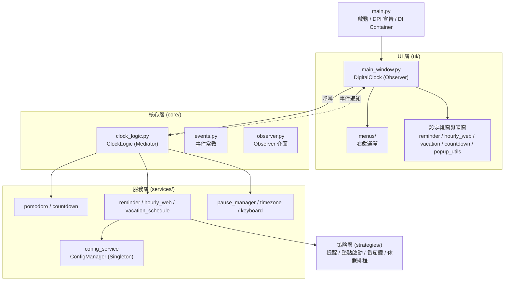

# 桌面數位時鐘 (Digital Clock)

## 緣起
當應用程式最大化時，自動隱藏的工具列雖然釋放了螢幕空間，卻也讓我們無法隨時看到時間。此專案旨在解決這個問題，提供一個簡潔、不干擾且永遠在最上層的桌面時鐘，並整合番茄鐘、倒數計時、提醒、整點啟動等小工具。

- 環境：Python 3.13+（tkinter）
- 依賴：`pynput`（全域鍵盤監聽）；Windows 另需 `tzdata`（多時區，已列入 `requirements.txt`）

---

## 功能總覽

### 時鐘本體
- **永遠置頂、半透明**：聚焦時不透明（預設 100%），失去焦點時降為預設 50%；兩種透明度皆可在選單調整（100/90/80/70/60%）。
- **可自由拖曳、雙擊關閉**；視窗被限制在可視範圍內（支援 Windows 多螢幕），啟動時若儲存的位置已不在螢幕內會自動移回。
- **滑鼠懸停顯示日期**：游標移到時間上時暫時改顯示日期（含星期），並自動縮小字級避免超出視窗。
- **字元級時間動畫**：時間切換時以字元垂直過渡呈現；動畫期高更新率、閒置期降頻，兼顧流暢與資源。
- **外觀可調**：8 種配色（護眼綠、紳士藍、暮色灰、大地棕、琥珀色、經典焦糖、深邃胡桃、柔和奶茶）、字型、字型大小（32–72）、12/24 小時制、完整/簡短日期、圓角（0/12/20/30/40）。
- **高 DPI 支援（Windows）**：啟動時宣告 DPI 感知，文字不會被系統放大而模糊；最小寬度、內距與圓角會依螢幕縮放。
- **不顯示在工作列**（Windows）；更改副檔名為 `.pyw` 可無主控台視窗背景執行。

### 時鐘下方資訊列
番茄鐘、倒數計時、多時區的資訊集中顯示在時鐘下方，由上而下依序為：

| 項目 | 範例 | 說明 |
|------|------|------|
| 番茄鐘 | `專注 24:16`、`短休息 04:30 (暫停)` | 專注/短休息/長休息階段與剩餘時間，暫停時加註 |
| 倒數計時 | `泡麵 倒數 02:54 (暫停)` | 名稱（可空白）與剩餘時間 |
| 多時區 | `東京 00:05 (+1)` | 最多 3 個，跨日以 `(+1)`、`(-1)` 標示 |

沒有任何項目時視窗維持原本大小；文字過寬時自動縮小字級。

### 效率工具
- **番茄鐘**：預設專注 25 分、短休息 5 分、長休息 15 分，每 4 個專注循環後長休息（可在設定檔 `pomodoro` 調整）。右鍵選單「效率提升 › 番茄鐘」可開始專注、暫停/繼續、取消番茄鐘；階段結束時彈窗提醒並自動進入下一階段。剩餘時間以截止時間計算，主迴圈延遲或漏 tick 不會造成誤差。
- **倒數計時**：「效率提升 › 倒數計時」提供 1/3/5/10/15/30 分鐘快速倒數與自訂（含名稱，上限 24 小時），可暫停、繼續、取消；結束時響鈴並彈窗。
- **多時區**：「時鐘設定 › 多時區」可從東京、首爾、新加坡、杜拜、巴黎、倫敦、UTC、紐約、芝加哥、洛杉磯、雪梨中勾選最多 3 個。

### 提醒
- **單次與週期提醒**：可指定日期時間，或每週固定星期與時間；提供「上班日」快捷勾選，單次提醒預設為目前時間 +5 分鐘。
- **標題與訊息**：彈窗訊息支援 Markdown 行內語法（粗體、斜體、`code`、連結）與可點擊網址（僅允許 http/https）。
- **稍後提醒**：彈窗左下角「稍後提醒 ▾」可延後 5 分鐘、10 分鐘、30 分鐘或 1 小時。
- **編輯、刪除、暫停**：由「提醒」選單管理；已過期的單次提醒於啟動時與檢查時自動清除。
- **非阻塞彈窗**：提醒以主 UI 執行緒中的視窗顯示，不會凍結時鐘，並限制同時堆疊數量（5 個）。

### 整點啟動
- 規則可為「網頁」或「程式」（程式路徑、參數、起始目錄），設定起訖整點時段（含邊界），每條規則可自訂星期；預設僅工作日觸發。
- 同一小時同一目標只觸發一次；程式一律不經 shell、不等待結束；網頁僅允許 http/https。
- 設定視窗可「立即測試」、編輯規則，並可**匯入 Windows 工作排程器 XML**（每日/每週觸發 + 啟動程式，自動轉為含星期條件的規則，不支援的設定列為警告）。
- 可獨立暫停/啟動。

### 休假模式
- 一鍵「立即開始休假 / 結束休假」：進入休假時停止番茄鐘並暫停提醒與整點啟動，結束後恢復切換前的暫停狀態。
- **休假排程**：設定日期範圍與備註，到期自動進入/離開休假；已過期或無效的排程自動清除。

### 智慧截圖躲避
以 `pynput` 在背景執行緒監聽 PrtScn 或 `Win+Shift+S`，偵測到截圖時自動隱藏（預設 2 秒），避免被攝入畫面；背景事件透過 `root.after` 安全交回主 UI 執行緒。

### 穩定性與健壯性
- **右鍵選單穩定**：選單開啟期間不會修改選單內容或視窗大小；資訊列每秒更新也不會重設正在使用的字型（Windows 上會讓選單被關閉）。
- **設定檔**：位於 `~/.digital_clock/config.json`；預設值遞迴合併、損毀時回退預設值、變更延遲寫入（防抖）、關閉時沖刷、以原子替換避免寫入中斷造成損毀。
- **日誌**：`~/.digital_clock/digital_clock.log`，單檔 5 MB、保留 3 份輪替。
- **效能監控**：可在設定檔 `system.performance_monitor` 啟用，定期輸出渲染與邏輯迴圈統計。

---

## 右鍵選單

```
休假模式 ›  立即開始休假 / 新增休假排程… / 既有排程
提醒 ›      新增提醒… / 暫停 / 既有提醒（編輯、刪除）
整點啟動 ›  設定 / 暫停
效率提升 ›
    番茄鐘 ›    開始專注 / 暫停（繼續）/ 取消番茄鐘
    倒數計時 ›  暫停（繼續）/ 取消倒數 / 1·3·5·10·15·30 分鐘 / 自訂…
時鐘設定 ›  多時區 / 字型 / 字型大小 / 配色 / 時間格式 / 日期格式 / 透明度 / 圓角
離開
```

---

## 啟動

### 跨平台雙擊啟動
啟動檔會自動建立 `.venv`、安裝 `requirements.txt` 並啟動 `main.py`。

| 平台 | 做法 |
|------|------|
| Windows | 雙擊 `start_windows.bat` |
| macOS | 首次執行 `chmod +x start_macos.command`，之後在 Finder 雙擊 |
| Linux | 首次執行 `chmod +x start_linux.sh`，之後在檔案管理器雙擊（詢問時選 Run） |

### 手動執行
```bash
pip install -r requirements.txt
python main.py
```

---

## 正式打包（Release Build）

使用 PyInstaller 產生單一執行檔（onefile）。

| 平台 | 指令 | 產出 |
|------|------|------|
| Windows | 雙擊 `package_windows.bat` | `dist/DigitalClock.exe` |
| macOS | `chmod +x package_macos.sh && ./package_macos.sh` | `dist/DigitalClock` |
| Linux | `chmod +x package_linux.sh && ./package_linux.sh` | `dist/DigitalClock` |

注意事項：
- 建議在目標平台各自打包。
- onefile 每次啟動都需解壓縮，啟動較慢；分發給 macOS 使用者通常還需簽章與公證，Windows 未簽署的執行檔可能被 SmartScreen 警告。

---

## 架構設計

分層設計，UI 與業務邏輯透過 **Observer** 解耦：UI 呼叫 `ClockLogic`，`ClockLogic` 以事件通知 UI。所有 UI 操作都在 tkinter 主執行緒。



### 目錄結構

```
digital_clock/
├── main.py                      # 進入點：日誌、DPI 宣告、建立 Container 並啟動
├── core/
│   ├── clock_logic.py           # ClockLogic：協調各服務、事件通知、延遲儲存
│   ├── events.py                # Events 事件名稱常數
│   ├── observer.py              # Observer 抽象介面
│   ├── container.py             # ServiceContainer（DI）
│   ├── launch_rules.py          # 整點啟動規則共用邏輯
│   ├── program_launcher.py      # 程式啟動（不經 shell、不等待）
│   ├── task_xml_importer.py     # 工作排程器 XML 匯入
│   └── url_validator.py         # URL 安全驗證（僅 http/https）
├── services/
│   ├── config_service.py        # ConfigManager（Singleton）
│   ├── pomodoro_service.py      # 番茄鐘引擎（含暫停）
│   ├── countdown_service.py     # 倒數計時引擎
│   ├── reminder_service.py      # 單次/週期提醒、稍後提醒
│   ├── hourly_web_service.py    # 整點啟動（網頁/程式）
│   ├── vacation_schedule_service.py  # 休假排程
│   ├── pause_manager.py         # 提醒/整點啟動/休假暫停狀態
│   ├── timezone_service.py      # 多時區
│   └── keyboard_service.py      # 截圖快捷鍵監聽
├── strategies/                  # BaseStrategy 及各可替換演算法
├── ui/
│   ├── main_window.py           # DigitalClock 主視窗
│   ├── popup_utils.py           # 主題化彈窗（含 Markdown 渲染）
│   ├── theme_utils.py           # 色彩計算、ttk 樣式、設計 token
│   ├── dpi.py                   # 高 DPI 支援
│   ├── window_bounds.py         # 視窗位置限制
│   ├── *_window.py              # 提醒/整點啟動/休假排程/倒數 設定視窗
│   └── menus/                   # 右鍵選單元件
├── tests/                       # unittest
├── package_*.{bat,sh}           # 各平台打包腳本
└── start_*.{bat,sh,command}     # 各平台雙擊啟動檔
```

### 設計模式

| 模式 | 位置 | 說明 |
|------|------|------|
| Observer | `core/observer.py` | `DigitalClock` 實作 `Observer`，訂閱 `ClockLogic` 以 `Events` 常數發出的事件 |
| Mediator | `core/clock_logic.py` | `ClockLogic` 協調各服務，服務透過 `notify_callback` 回報 |
| Strategy | `strategies/` | 提醒、整點啟動、番茄鐘階段、休假排程的判斷邏輯可替換，須繼承 `BaseStrategy` |
| Singleton | `services/config_service.py` | `ConfigManager` 確保設定管理器唯一 |
| DI Container | `core/container.py` | 以名稱註冊/取得服務 |

### 程式碼慣例
- 絕對 import；snake_case 方法、PascalCase 類別、UPPER_CASE 常數；完整 type hints；Google-style 繁體中文 docstring。
- 事件名稱一律使用 `Events` 常數，不使用 magic string；日誌使用 `logging`，不使用 `print`。
- 所有彈窗走 `popup_utils` / `theme_utils`（`themed_error`、`themed_confirm`），不直接使用 `tkinter.messagebox`，以確保主題一致。

---

## 開發

```bash
python -m unittest discover -s tests      # 執行全部測試
pip install -e ".[dev]"                   # 安裝 ruff、coverage
python -m ruff check ui core services strategies tests main.py
```

- 測試使用標準庫 `unittest`；涉及 `ConfigManager` 時須先 `ConfigManager._instance = None` 重設單例，並 mock `Path.home()`。
- 部分 UI 測試需要可用的顯示器，無顯示器時會自動略過。
- 更多開發約定見 [AGENTS.md](AGENTS.md)。

---

本專案適合需要極簡、穩定、可擴充的桌面時鐘解決方案的使用者與開發者。
