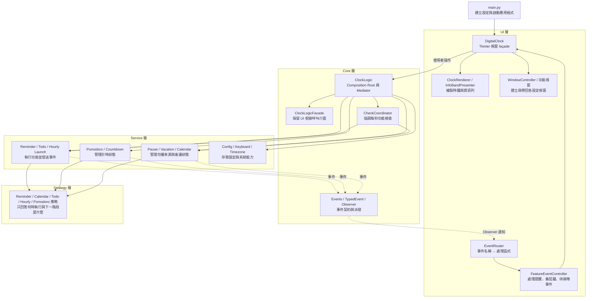

# 架構設計

> 本文件以「追蹤一次操作如何流過程式」為主線，適合第一次接觸專案的工程師。
> 更完整的功能說明請見 [功能說明](features.md)，修改與測試慣例請見 [開發指南](development.md)。


## 1. 先用一句話理解整個專案

Digital Clock 是一個以 Tkinter 製作的桌面應用程式：

```text
UI 接收使用者操作
→ Core 負責協調
→ Service 執行功能
→ Strategy 判斷現在該不該執行
→ 透過 Observer 事件通知 UI
→ UI 更新畫面或顯示彈窗
```

最重要的設計原則是：

> Service 不直接操作 Tkinter；UI 也不自行判斷提醒、排程與時間狀態。

兩邊透過事件連接，因此功能邏輯可以單獨測試，UI 也不需要知道 Service 的內部實作。

---

## 2. 架構總覽



### 三個最重要的元件

| 元件 | 角色 | 可以把它想成 |
|---|---|---|
| `DigitalClock` | 建立 Tkinter 視窗並接收 Observer 事件 | 櫃台 |
| `ClockLogic` | 組合 Service、協調生命週期、派發事件 | 交通指揮中心 |
| `CheckCoordinator` | 每秒依固定順序執行時間相關檢查 | 排程總管 |

---

## 3. 專案啟動流程

程式入口是 [`main.py`](../main.py)。

```text
設定日誌
→ 建立 ConfigManager
→ 啟用 DPI 支援
→ 建立 DigitalClock
→ DigitalClock 建立 ClockLogic 與 UI
→ ClockLogic.start()
→ 進入 Tkinter mainloop
```

### `main.py` 為什麼很短？

因為入口只負責組裝，不應包含提醒、番茄鐘或設定視窗的細節。若要理解「程式先做了什麼」，先看：

1. [`main.py`](../main.py)
2. [`ui/main_window.py`](../ui/main_window.py)
3. [`core/clock_logic.py`](../core/clock_logic.py)

---

## 4. 一次功能操作如何流動

以「使用者開始 5 分鐘倒數」為例：

```text
使用者點選右鍵選單
→ CountdownMenu 呼叫 ClockLogicFacade.start_countdown()
→ CountdownService.start() 建立計時狀態
→ CountdownService 發送 COUNTDOWN_STARTED
→ ClockLogic 派發給 Observer
→ DigitalClock 更新資訊列
→ 每秒再次 tick
→ 結束後發送 COUNTDOWN_FINISHED
→ UI 顯示結束彈窗
```

這個例子展示本專案的標準方向：

```text
UI 命令
→ Facade
→ Service
→ Event
→ UI 回應
```

UI 不直接實作倒數規則，Service 也不直接建立 Tkinter 彈窗。

---

## 5. 分層說明

### 5.1 UI 層

位置：[`ui/`](../ui)

UI 層只處理畫面與使用者互動：

- 建立與管理 Tkinter 視窗
- 處理滑鼠、鍵盤與選單命令
- 接收 Observer 事件
- 更新時間、資訊列與彈窗

#### `DigitalClock`

[`DigitalClock`](../ui/main_window.py) 是 UI 的 façade，也就是統一入口。

初始化時主要做三件事：

```python
self.logic = ClockLogic(self, config_manager)
self.logic.add_observer(self)
self.logic.start()
```

代表：

1. 建立核心協調器
2. 註冊自己為 Observer
3. 啟動背景服務與初始檢查

#### `FeatureEventController`

[`FeatureEventController`](../ui/feature_event_controller.py) 集中處理功能事件，例如：

- `_on_reminder_due`
- `_on_pomodoro_tick`
- `_on_todo_updated`
- `_on_calendar_event_started`
- `_on_screenshot_triggered`

`DigitalClock` 繼承這個 controller，因此既有事件方法名稱仍維持相容。

這次拆分的目的不是改變行為，而是讓 `DigitalClock` 不必繼續承擔所有 `_on_*` 方法。

#### Renderer 與 Presenter

高頻率繪圖已從主視窗拆出：

- [`ClockRenderer`](../ui/clock_renderer.py)：時鐘文字、動畫、字元快取
- [`InfoBandPresenter`](../ui/info_band_presenter.py)：番茄鐘、倒數、待辦、多時區資訊列
- [`WindowController`](../ui/window_controller.py)：建立、重用與帶回功能視窗

原因是畫面更新很頻繁，集中在一個類別會難以維護與測試。

---

### 5.2 Core 層

位置：[`core/`](../core)

Core 層負責跨功能協調，但不負責繪製 Tkinter 視窗。

#### `ClockLogic`

[`ClockLogic`](../core/clock_logic.py) 是 Composition Root 與 Mediator：

- 建立各個 Service
- 把 callback 與依賴注入 Service
- 管理 Observer
- 派發事件
- 啟動背景服務
- 延遲並合併設定儲存
- 正確停止所有服務

它不是「所有程式都寫在這裡」，而是：

> 知道哪些物件存在，並讓它們合作。

#### `ClockLogicFacade`

[`ClockLogicFacade`](../core/clock_logic_facade.py) 收納 UI 對功能服務的 delegate 方法。

例如：

```python
logic.start_countdown(...)
logic.open_todo_window()
logic.toggle_timezone(...)
logic.update_calendar_sync_settings(...)
```

Facade 的責任是轉交給正確 Service，不重新實作功能規則。

這讓未來可以替換內部 Service，而不必一次修改全部 UI 呼叫點。

#### `CheckCoordinator`

[`CheckCoordinator`](../core/check_coordinator.py) 每秒執行一次時間相關檢查，固定順序為：

1. 勿擾排程
2. 行事曆
3. 整點啟動
4. Todo 到期提醒
5. 一般提醒

順序很重要。若排程或行事曆先進入勿擾，後續提醒就必須被暫停。

---

### 5.3 Service 層

位置：[`services/`](../services)

Service 是真正執行功能的地方。

例如 [`ReminderService`](../services/reminder_service.py) 負責：

- 新增、更新、刪除提醒
- 儲存設定
- 呼叫 Strategy 判斷
- 移除已觸發的單次提醒
- 發送 `REMINDER_DUE`
- 建立稍後提醒

Service 可以產生副作用，例如：

- 寫入 JSON
- 開啟瀏覽器
- 啟動外部程式
- 發送 Observer 事件
- 啟動或停止背景執行緒

初學者可以記成：

> Service = 怎麼執行這項功能。

---

### 5.4 Strategy 層

位置：[`strategies/`](../strategies)

Strategy 只負責決策，盡量不處理檔案或 UI。

例如 [`ReminderStrategy`](../strategies/reminder_strategy.py) 回答：

- 今天星期是否符合？
- 現在時間是否相同？
- 單次提醒是否已到期？
- 週期提醒這分鐘是否已觸發？

Service 再根據結果執行儲存、通知與刪除。

可以記成：

> Strategy = 現在應不應該執行。

| 問題 | Service 或 Strategy |
|---|---|
| 現在是否該觸發提醒？ | Strategy |
| 觸發後要不要刪除單次提醒？ | Service |
| 番茄鐘下一階段是短休息還是長休息？ | Strategy |
| 開始下一階段並發送事件？ | Service |
| Todo 現在是否到期？ | Strategy |
| 將 Todo 變更存入 `todos.json`？ | Service |

---

## 6. Observer 事件系統

Observer 是 UI 與 Service 解耦的主要方式。

### 6.1 為什麼不讓 Service 直接更新 UI？

不建議：

```python
digital_clock.show_reminder(reminder)
```

原因：

- Service 會依賴 Tkinter
- Service 不容易單獨測試
- 增加新 UI 接收者時要修改 Service
- 背景執行緒可能直接操作 UI

目前做法是：

```python
self.notify(Events.REMINDER_DUE, reminder)
```

Service 只表示「提醒到期了」，不決定誰負責顯示。

### 6.2 事件名稱集中管理

事件名稱集中在 [`core/events.py`](../core/events.py)：

```python
Events.REMINDER_DUE
Events.TODO_UPDATED
Events.COUNTDOWN_FINISHED
Events.CALENDAR_EVENT_STARTED
```

不要直接寫 magic string：

```python
notify("reminder_due", reminder)
```

使用常數的好處：

- 避免拼字錯誤
- 容易搜尋事件來源
- 修改時只需修改一處
- 更容易驗證 payload

### 6.3 事件派發

[`ClockLogic.notify_observers()`](../core/clock_logic.py) 會：

1. 驗證已知事件的 payload
2. 依序呼叫每個 Observer
3. 某個 Observer 失敗時記錄錯誤
4. 繼續通知其他 Observer

這確保一個通知模組出錯，不會中斷其他功能。

### 6.4 UI 事件路由

[`EventRouter`](../ui/event_router.py) 維護字典：

```python
{
    Events.REMINDER_DUE: ui._on_reminder_due,
    Events.TODO_UPDATED: ui._on_todo_updated,
    Events.COUNTDOWN_FINISHED: ui._on_countdown_finished,
}
```

`DigitalClock.update()` 只需依事件名稱找出 handler，不需要大量 `if/elif`。

---

## 7. 完整案例：一筆提醒如何觸發

假設使用者設定「每天 09:00 提醒」。

### 第一階段：每秒喚起檢查

```text
Tkinter update loop
→ ClockLogicFacade.check_reminders(now)
→ CheckCoordinator.check(now)
```

### 第二階段：提醒判斷

```text
ReminderService.check_reminders(...)
→ ReminderStrategy.check(...)
→ 回傳符合條件的提醒
```

### 第三階段：Service 執行副作用

若是單次提醒，Service 會：

```text
從設定移除該筆提醒
→ 儲存設定
→ 發送 REMINDER_DUE
```

### 第四階段：事件回到 UI

```text
ClockLogic.notify_observers(...)
→ DigitalClock.update(...)
→ EventRouter 找到 _on_reminder_due
→ FeatureEventController 顯示提醒彈窗
```

完整流程：

```text
時間更新
→ Coordinator
→ ReminderService
→ ReminderStrategy
→ REMINDER_DUE
→ Observer
→ EventRouter
→ FeatureEventController
→ Tkinter 彈窗
```

---

## 8. 設定與資料如何保存

專案使用兩份本機 JSON，不使用資料庫。

| 檔案 | 內容 |
|---|---|
| `~/.digital_clock/config.json` | 外觀、提醒、番茄鐘、勿擾、整點啟動、行事曆、多時區等設定 |
| `~/.digital_clock/todos.json` | 待辦樹與任務資料 |

### 為什麼 UI 儲存不能每次都直接寫檔？

拖曳視窗、調整透明度或改字型可能頻繁呼叫設定更新。

若每次都直接寫入：

- UI 可能卡頓
- 磁碟 I/O 次數過多
- 不同 Service 可能互相覆蓋設定

因此目前流程是：

```text
UI / Service 修改記憶體設定
→ schedule_save()
→ 合併最新設定
→ ConfigWriter 背景佇列
→ 寫入 .tmp
→ flush/fsync
→ os.replace() 原子替換正式檔案
```

關閉程式時，`ClockLogic.on_close()` 會先完成待儲存內容，再停止背景服務。

---

## 9. Todo 為什麼使用 Command 模式

Todo 需要支援：

- 新增、編輯、刪除
- 移動父子層級
- 一次修改多項
- 復原與重做
- 匯入與還原備份

因此每次變更不能只直接修改 `tasks`，而應建立一個 Command：

- `AddTaskCommand`
- `UpdateTaskCommand`
- `DeleteTasksCommand`
- `MoveTaskCommand`
- `ToggleDoneCommand`
- `RemoveLinkCommand`
- `ImportTasksCommand`

標準流程：

```text
TodoService 建立 Command
→ command.execute()
→ 有實際變更才加入 History
→ 儲存 todos.json
→ 發送 TODO_UPDATED
```

`execute()` 回傳 `False` 時代表沒有真正改變，因此不需要加入復原紀錄。

---

## 10. Tkinter 執行緒規則

Tkinter 畫面操作必須在主執行緒。

專案內仍有三種背景工作：

- 行事曆網路同步
- 全域鍵盤監聽
- 設定檔背景寫入

### 正確作法

背景工作完成後，透過 `root.after()` 回到 Tkinter 主執行緒：

```python
root.after(0, callback)
```

例如截圖快捷鍵是在背景鍵盤監聽產生，但隱藏時鐘會回到主執行緒執行。

### 不正確作法

不要在背景執行緒直接：

- 修改 Label
- 關閉視窗
- 更新 Canvas
- 建立 Toplevel

---

## 11. 設計模式速查

| 模式 | 位置 | 用途 |
|---|---|---|
| Composition Root | `core/clock_logic.py` | 建立與連接所有 Service |
| Mediator | `ClockLogic` | 協調不同功能，不讓它們直接互相呼叫 UI |
| Facade | `ClockLogicFacade` | 提供 UI 簡單且相容的呼叫入口 |
| Observer | `core/observer.py` | Service 發事件，UI 與通知中心訂閱 |
| Strategy | `strategies/` | 抽出時間、排程與階段判斷 |
| Command | `core/todo_commands.py` | Todo 的復原與重做 |
| Presenter / Renderer | `ui/clock_renderer.py`、`ui/info_band_presenter.py` | 拆出高頻 Canvas 繪圖 |

---

## 12. 目錄結構

```text
digital_clock/
├── main.py                         程式入口
├── core/                           協調、事件、跨功能規則與 Todo domain
│   ├── clock_logic.py
│   ├── clock_logic_facade.py
│   ├── check_coordinator.py
│   ├── events.py
│   ├── typed_events.py
│   ├── observer.py
│   └── todo_commands.py
├── services/                       功能執行、持久化與系統整合
│   ├── reminder_service.py
│   ├── pomodoro_service.py
│   ├── countdown_service.py
│   ├── todo_service.py
│   ├── calendar_sync_service.py
│   ├── pause_manager.py
│   └── config_writer.py
├── strategies/                     時間與階段決策
│   ├── reminder_strategy.py
│   ├── todo_due_strategy.py
│   ├── hourly_web_strategy.py
│   └── pomodoro_strategy.py
├── ui/                             Tkinter 畫面與使用者互動
│   ├── main_window.py
│   ├── feature_event_controller.py
│   ├── event_router.py
│   ├── window_controller.py
│   ├── clock_renderer.py
│   ├── info_band_presenter.py
│   └── menus/
└── tests/                          unittest 測試
```

---

## 13. 初學者建議閱讀順序

第一次閱讀專案，建議依照資料流前進：

1. [`main.py`](../main.py)：程式如何開始
2. [`ui/main_window.py`](../ui/main_window.py)：Tkinter 如何組裝
3. [`core/clock_logic.py`](../core/clock_logic.py)：Service 如何建立與協調
4. [`core/clock_logic_facade.py`](../core/clock_logic_facade.py)：UI 如何呼叫功能
5. [`core/check_coordinator.py`](../core/check_coordinator.py)：每秒如何檢查
6. [`services/reminder_service.py`](../services/reminder_service.py)：Service 如何執行
7. [`strategies/reminder_strategy.py`](../strategies/reminder_strategy.py)：Strategy 如何判斷
8. [`core/events.py`](../core/events.py)：事件名稱有哪些
9. [`ui/event_router.py`](../ui/event_router.py)：事件如何對應 UI handler
10. [`ui/feature_event_controller.py`](../ui/feature_event_controller.py)：UI 如何回應事件

讀每個功能時，固定問四個問題：

```text
1. 誰觸發？
2. 由哪個 Service 執行？
3. 時間判斷在哪個 Strategy？
4. 最後由哪個 UI handler 更新畫面？
```

---

## 14. 常見修改應該放在哪裡？

| 需求 | 建議位置 |
|---|---|
| 增加新的提醒時間規則 | `strategies/` |
| 增加提醒、休假或同步的實際處理 | `services/` |
| 增加 UI 元件或視窗 | `ui/` |
| 增加跨模組生命週期或組裝 | `core/clock_logic.py` |
| 增加 UI 可呼叫的功能入口 | `core/clock_logic_facade.py` |
| 增加服務事件名稱 | `core/events.py` |
| 增加事件對 UI handler 的映射 | `ui/event_router.py` |
| 增加事件發生後的彈窗或畫面更新 | `ui/feature_event_controller.py` |
| 增加 Todo 可復原操作 | `core/todo_commands.py` 與 `services/todo_service.py` |

---

## 15. 最後記住四條架構原則

1. **UI 只處理畫面與使用者互動。**
2. **Service 執行功能與副作用，Strategy 只做判斷。**
3. **跨層溝通使用 `Events` 與 Observer，不直接操作對方 UI。**
4. **所有背景工作進入 Tkinter 前，都要回到主執行緒。**

只要沿著「入口 → UI → Core → Service → Strategy → Event → UI」追蹤，就能理解本專案大部分功能。
