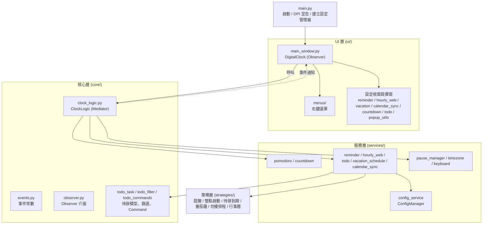

# 架構設計

分層設計，UI 與業務邏輯透過 **Observer** 解耦：UI 呼叫 `ClockLogic`，`ClockLogic` 以事件通知 UI。所有 UI 操作都在 tkinter 主執行緒。



## 目錄結構

```
digital_clock/
├── main.py                      # 進入點：日誌、DPI 宣告、建立設定管理器並啟動
├── core/
│   ├── clock_logic.py           # ClockLogic：協調各服務、事件通知、延遲儲存
│   ├── events.py                # Events 事件名稱常數
│   ├── observer.py              # Observer 抽象介面
│   ├── launch_rules.py          # 整點啟動規則共用邏輯
│   ├── program_launcher.py      # 程式啟動（不經 shell、不等待）
│   ├── program_safety.py        # 程式規則的可執行性與設定驗證
│   ├── task_xml_importer.py     # 工作排程器 XML 匯入
│   ├── todo_task.py            # 待辦資料模型與日期輸入解析
│   ├── todo_filter.py          # 待辦篩選、搜尋與統計
│   ├── todo_commands.py        # 待辦 Command（可復原操作）與 CommandHistory
│   └── url_validator.py         # URL 安全驗證（僅 http/https）
├── services/
│   ├── config_service.py        # ConfigManager
│   ├── pomodoro_service.py      # 番茄鐘引擎（含暫停）
│   ├── countdown_service.py     # 倒數計時引擎
│   ├── reminder_service.py      # 單次/週期提醒、稍後提醒
│   ├── hourly_web_service.py    # 整點啟動（網頁/程式）
│   ├── todo_service.py          # 待辦事項：任務樹、復原/重做、整點到期提醒
│   ├── todo_store.py            # todos.json 原子寫入、損毀備份、匯入匯出
│   ├── vacation_schedule_service.py  # 勿擾排程
│   ├── calendar_sync_service.py # Outlook ICS 同步，事件進行中自動勿擾
│   ├── pause_manager.py         # 提醒/整點啟動/勿擾暫停狀態
│   ├── timezone_service.py      # 多時區
│   └── keyboard_service.py      # 截圖快捷鍵監聽
├── strategies/                  # BaseStrategy 及各可替換演算法
├── ui/
│   ├── main_window.py           # DigitalClock 主視窗
│   ├── popup_utils.py           # 主題化彈窗（含 Markdown 渲染）
│   ├── theme_utils.py           # 色彩計算、ttk 樣式、設計 token
│   ├── dpi.py                   # 高 DPI 支援
│   ├── window_bounds.py         # 視窗位置限制
│   ├── file_drop.py             # 選用的拖放支援（tkinterdnd2）
│   ├── *_window.py              # 提醒/整點啟動/勿擾排程/行事曆同步/倒數/待辦 視窗
│   ├── todo_edit_dialog.py      # 待辦新增/編輯對話框
│   └── menus/                   # 右鍵選單元件
├── tests/                       # unittest
├── package_*.{bat,sh}           # 各平台打包腳本
└── start_*.{bat,sh,command}     # 各平台雙擊啟動檔
```

## 設計模式

| 模式 | 位置 | 說明 |
|------|------|------|
| Observer | `core/observer.py` | `DigitalClock` 實作 `Observer`，訂閱 `ClockLogic` 以 `Events` 常數發出的事件 |
| Mediator | `core/clock_logic.py` | `ClockLogic` 協調各服務，服務透過 `notify_callback` 回報 |
| Strategy | `strategies/` | 提醒、整點啟動、待辦到期、番茄鐘階段、勿擾排程、行事曆事件的判斷邏輯可替換，須繼承 `BaseStrategy` |
| Command | `core/todo_commands.py` | 待辦的每個操作都是可執行、可復原的 `TodoCommand`，由 `CommandHistory`（上限 50 步）記錄，`TodoService` 負責執行與存檔 |

## 程式碼慣例

- 絕對 import；snake_case 方法、PascalCase 類別、UPPER_CASE 常數；完整 type hints；Google-style 繁體中文 docstring。
- 事件名稱一律使用 `Events` 常數，不使用 magic string；日誌使用 `logging`，不使用 `print`。
- 所有彈窗走 `popup_utils` / `theme_utils`（`themed_error`、`themed_confirm`），不直接使用 `tkinter.messagebox`，以確保主題一致。

更多開發約定見 [AGENTS.md](../AGENTS.md)。
